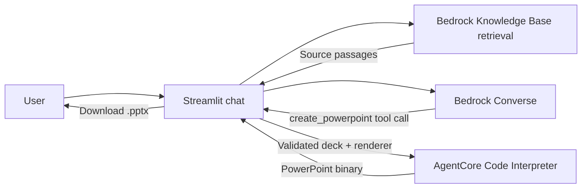

# Chat to PowerPoint — Bedrock + AgentCore PoC

A local Streamlit chatbot uses Amazon Bedrock Converse for conversation and tool
calling. When the user requests a presentation, it calls AgentCore Code Interpreter
to execute a trusted Python renderer and downloads the resulting `.pptx` using
`readFiles`. PowerPoint generation happens inside AgentCore.



## Run

Quick start after configuring your local `.env` file:

```sh
cd agentcore-pptx-poc
bash run.sh
```

The launcher opens SSO login if needed, installs dependencies and starts the app at http://localhost:8501. It lists roles assigned to the configured account and verifies the active account before launch. Configure local account, profile and SSO values in `.env` (copy `.env.example`). Enter your Bedrock
model or inference profile ID in the app sidebar. The default service region is
US East (N. Virginia) (`us-east-1`); override it with `AWS_REGION=your-region bash run.sh`.

The sample model setting is Amazon Nova Pro. Choose a model or inference profile available in your configured region. Converse tool use is supported without Anthropic's
use-case submission. If you choose Claude instead, complete the Anthropic
use-case form in the Bedrock console first. All models still require IAM access
and available account quotas.

The launcher uses the project-local `aws-config` through `AWS_CONFIG_FILE`. It
is generated from your local `.env` settings; the checked-in example contains placeholders. First run selects an assigned role,
without opening the AWS account-selection wizard. This leaves your global
`~/.aws/config` untouched.

Requires Python 3.10+, configured AWS credentials, a region supporting AgentCore
Code Interpreter, and access to a Bedrock model that supports Converse tool use.
Choose a model or inference profile ID available to your account and region.

```sh
cd agentcore-pptx-poc
python3 -m venv .venv
source .venv/bin/activate
pip install -r requirements.txt
export AWS_PROFILE=your-profile
export AWS_REGION=us-east-1
export BEDROCK_MODEL_ID=your-model-or-inference-profile-id
streamlit run app.py --server.address 127.0.0.1
```

For an SSO profile, run `aws sso login --profile your-profile` first.
Model ID, region and interpreter ID can also be set in the sidebar.
The default interpreter is `aws.codeinterpreter.v1`; no custom interpreter or
AgentCore Runtime deployment is needed. The chatbot runs locally while Bedrock and
Code Interpreter run in AWS. Service calls incur AWS charges.

## Try it

Expand **Try a sample: AI pilot report** in the chatbot and click **Generate sample
report**. The full editable prompt lives in `sample_prompt.txt`. It requests an
eight-slide proposed AI pilot report for Devoteam, with a recommendation, candidate
workflows, a four-week plan, measurement, risks and a decision. It explicitly avoids
inventing completed results or company data. The button forces the generation tool.

1. “I need 6 slides about migrating our CRM to AWS, for a nontechnical leadership team.”
2. “Use English. Focus on operational benefits, migration stages, and risks.”
3. “Generate the PowerPoint.”
4. Download the file, then ask: “Make it shorter and add a next steps slide.”

Each deck has a cover plus 1–15 content slides, editable text cards and speaker
notes. Ask for the desired total count; the model is told to account for the cover.
The chat can generate immediately if enough information is present; the Generate
PowerPoint button also sends an explicit generation request.

## Knowledge base grounding (RAG)

RAG uses the ID configured in `BEDROCK_KNOWLEDGE_BASE`.
The sidebar accepts a knowledge base ID, knowledge base name, or data source name.
For a data source name, the app finds its parent KB and filters retrieval to that
source. Managed Knowledge Bases use `managedSearchConfiguration` for retrieval.
The default knowledge base region is `us-east-1`; change it in the sidebar if needed.
Environment defaults are `BEDROCK_KNOWLEDGE_BASE` and `BEDROCK_KB_REGION`.

On each chat request, the app retrieves up to six passages using the user’s
conversation requirements (bounded to the last 20,000 characters). Each passage
is bounded to 5,000 characters before being supplied to Converse as reference
material. The model is instructed to cite source IDs and locations in speaker
notes. Retrieved passages and locations also appear below each generated deck.
Citations are model-generated and should be reviewed for important claims.
Empty retrieval is reported in progress and to the model; AWS retrieval failures
stop the request instead of silently skipping RAG. The sidebar can disable RAG.
The existing KB must already be ingested; the app does not create or sync it.

The caller additionally needs `bedrock:Retrieve` on the knowledge base ARN
(`arn:aws:bedrock:REGION:ACCOUNT:knowledge-base/ID`). Name resolution requires
`bedrock:ListKnowledgeBases` and, for data source names, `bedrock:ListDataSources`.
Supplying a KB ID avoids those discovery calls.

Retrieval uses the [Bedrock Retrieve API](https://docs.aws.amazon.com/boto3/latest/reference/services/bedrock-agent-runtime/client/retrieve.html).
Run local mocked checks with `.venv/bin/python -m unittest discover -s tests -v`.

## Permissions

The caller needs `bedrock:InvokeModel` on the selected model and, when applicable,
its inference profile and underlying models. It also needs:

* `bedrock-agentcore:StartCodeInterpreterSession`
* `bedrock-agentcore:InvokeCodeInterpreter`
* `bedrock-agentcore:StopCodeInterpreterSession`

For the built-in interpreter, the resource ARN uses the AWS-owned account segment:
`arn:aws:bedrock-agentcore:REGION:aws:code-interpreter/aws.codeinterpreter.v1`.
For a custom interpreter, use its actual resource ARN. The app does not create IAM
roles, change permissions or deploy infrastructure.

## Design and limits

The generation instructions live in `presentation_prompt.txt`. They guide audience
adaptation, narrative structure, takeaway titles, specific examples, speaker notes,
evidence handling and a final self-review. Edit that file and restart Streamlit to
try prompt variants. The renderer still determines the visual layout; prompt
changes improve content and cannot add charts or new slide layouts by themselves.

* Full conversation and completed downloads stay in Streamlit session memory;
  refreshes/restarts can discard them. New conversation clears them.
* A fresh interpreter session is used for each deck and stopped in `finally`;
  a five-minute TTL also limits abandoned sessions.
* Bedrock supplies a JSON deck, not executable code. JSON Schema validates the
  content before a fixed renderer runs in AgentCore. No local model code execution.
* Boto3 handles binary blob decoding; the PowerPoint is not base64-decoded again.
* This is a local PoC, with no login, shared storage, uploads, web research,
  company templates, charts or generated images. Long chats are not summarized.
* Content is model-generated and should be reviewed. Character limits reduce
  overflow but are not a substitute for visual review in PowerPoint.
* End-to-end AWS operation requires valid credentials, permissions and model
  access.

## AWS observability in US East (N. Virginia)

This instruments the locally hosted agent using ADOT; it does not deploy an
AgentCore Runtime or create a custom Code Interpreter. Application spans measure
Bedrock requests, the PowerPoint tool, and AgentCore start/execute/read/stop calls.
Interpreter sessions, AWS request IDs and trace IDs are correlated in operational
events. These client-side spans are distinct from service-generated interpreter
traces or Python stdout. No native interpreter tracing toggle is changed.

Everything runs through one command in the AWS account and region configured in `.env`:

```sh
bash run.sh
```

The launcher handles SSO, dependency installation, initial observability setup,
a test trace, delivery verification and app startup. Existing AWS setup is reused.
It waits for one of this startup's test trace IDs to arrive before opening the app,
retrying every 15 seconds and resending a test trace each minute. On first setup,
this may take ten minutes; after eleven minutes without receipt it stops with an
error. Old spans cannot satisfy this startup check. Rerun the same command after
resolving a permissions or exporter error.

The setup creates `/devoteam/agentcore-pptx` (14-day event retention), adds an
X-Ray log-delivery resource policy and
sets the regional X-Ray trace destination to CloudWatch Logs. This is an
account/region-level Transaction Search setting. Shared trace retention and
indexing sampling are preserved; ingestion and indexing can incur AWS charges.
Initial activation can take ten minutes. The startup test emits a span without calling
Bedrock or starting an interpreter. Export attempted is not proof of receipt.

Optional diagnostics (not required for normal startup):

```sh
bash run.sh --verify-observability
bash run.sh --smoke-observability
bash run.sh --setup-observability
```

Verification searches `aws/spans` for `devoteam-pptx-agent` in the last 30 minutes
and exits with an error if nothing is received. Normal startup instead verifies
its own fresh test trace before starting Streamlit.

In the CloudWatch console for your configured AWS region:

* **Logs → Log groups → `/devoteam/agentcore-pptx`**: operational events, including
  session ID, request ID and trace ID. These events are written directly by our app.
* **Logs → Log groups → `aws/spans`**: OpenTelemetry spans. Search for service name
  `devoteam-pptx-agent`, or the trace ID printed in the app.
* **Application Signals (APM) → Transaction Search**: search the same service and
  time range. Search results also depend on the account's existing indexing rate.

To inspect raw spans with Logs Insights on `aws/spans`:

```text
fields @timestamp, @message
| filter @message like /devoteam-pptx-agent/
| sort @timestamp desc
| limit 50
```

The caller needs setup permissions `logs:CreateLogGroup`, `logs:PutRetentionPolicy`,
`logs:PutResourcePolicy`, `xray:UpdateTraceSegmentDestination`, and
`xray:GetTraceSegmentDestination`. Runtime telemetry additionally needs
`xray:PutTraceSegments`, `logs:CreateLogStream` and `logs:PutLogEvents` on the
app log group. Verification needs `logs:FilterLogEvents` on `aws/spans`.
Automatic setup discovery needs `logs:DescribeResourcePolicies` and
`logs:DescribeLogGroups`.
The setup does not attach IAM policies or grant itself permissions. If denied,
have an administrator run setup or grant these actions, scoped where supported.

Custom telemetry contains metadata, not prompts, slide text, executable source,
file bytes or access tokens. The launcher disables automatic Bedrock/botocore
instrumentation and uses our manual spans to control recorded fields. SSO
credentials are resolved through the existing profile. ADOT is initialized once
by `opentelemetry-instrument`, before Streamlit starts, and spans are flushed after
each request. Running plain `streamlit run app.py` bypasses the observability
environment; use the launcher.

AWS references: [local agent ADOT setup](https://docs.aws.amazon.com/bedrock-agentcore/latest/devguide/observability-get-started.html),
[Transaction Search and context propagation](https://docs.aws.amazon.com/bedrock-agentcore/latest/devguide/observability-configure.html).

## AWS references

* [Direct Code Interpreter usage](https://docs.aws.amazon.com/bedrock-agentcore/latest/devguide/code-interpreter-using-directly.html)
* [Code execution and file operations](https://docs.aws.amazon.com/bedrock-agentcore/latest/devguide/code-interpreter-api-reference-examples.html)
* [Preinstalled libraries, including python-pptx](https://docs.aws.amazon.com/bedrock-agentcore/latest/devguide/code-interpreter-preinstalled-libraries.html)
* [Converse client-side tool use](https://docs.aws.amazon.com/bedrock/latest/userguide/tool-use-client-side.html)
* [AgentCore resource authorization](https://docs.aws.amazon.com/service-authorization/latest/reference/list_bedrock-agentcore.html)


For a retrieval test, load `rag-test.txt` into the configured Bedrock knowledge base,
wait for ingestion to complete, then use the **Orion Field Station RAG test** sample.
The sample asks for distinctive facts from that document and requires source
references in speaker notes. The knowledge base must contain the test document
for this sample to return its expected facts.
